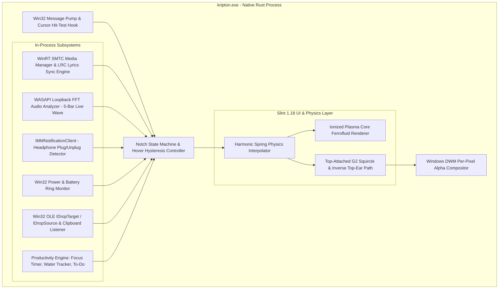

# Product Requirements Document (PRD)
# Project: "Kripton" — Native Windows Living Notch in Rust
**Repository Path:** `E:\Project\Kripton`  
**Target Platform:** Windows 10 (Build 19041+) & Windows 11 (x86_64 / ARM64)  
**Tech Stack:** 100% Native Rust + Slint UI + Win32/WinRT C-ABI  
**Document Version:** 2.0 (Full 10-Mode Specification & Ionized Plasma Core Mascot)  
**Status:** Siap Implementasi & Produksi

---

## 1. Executive Summary & Vision

**Kripton** adalah aplikasi *desktop overlay* mandiri (*standalone*) berperforma ultra-tinggi untuk Windows 10 & 11 yang mentransformasi area tengah atas layar menjadi **Living Notch** yang interaktif, adaptif, dan hidup. Kripton dirancang untuk menyamai seluruh fungsionalitas, presisi tata letak, dan keluwesan animasi fisika pegas (*spring physics*) dari aplikasi referensi, namun memiliki identitas visual eksklusif melalui maskot **Ionized Plasma Core**.

Dibangun menggunakan **100% bahasa pemrograman Rust murni dan Slint UI**, Kripton mengeliminasi ketergantungan pada *runtime* Chromium/Electron atau Node.js, menghasilkan konsumsi memori yang sangat rendah serta eksekusi *zero-jank* pada *refresh rate* tinggi ($60\text{ Hz}$ hingga $240\text{ Hz}$).

### 1.1. Target Metrik Performa vs Baseline Lama

| Metrik Performa | Target Kripton (Rust + Slint) | Pembanding (Electron / Webview) |
| :--- | :--- | :--- |
| **Idle Memory (RAM)** | $< 35\text{ MB}$ | $450\text{ MB} - 550\text{ MB}$ |
| **Active Memory (RAM - Lyrics & Shelf)** | $< 60\text{ MB}$ | $> 600\text{ MB}$ |
| **Idle CPU Usage (Mode Istirahat/Tertutup)** | $0.0\% - 0.3\%$ (*Event-driven*) | $1.5\% - 4.0\%$ (*Polling loop*) |
| **Active Frame Time** | $< 2.0\text{ ms}$ ($\ge 120\text{ FPS}$ stabil) | $8\text{ ms} - 22\text{ ms}$ (Rawan *GC stutter*) |
| **Cold Startup Time** | $< 300\text{ ms}$ | $2000\text{ ms} - 4000\text{ ms}$ |
| **Ukuran Binary Rilis** | $< 12\text{ MB}$ (Single portable `.exe`) | $180\text{ MB} - 250\text{ MB}$ |
| **Jumlah Proses Berjalan** | $1$ (*Single native OS process*) | $5 - 6$ *child processes* |

---

## 2. Non-Goals (Batasan Arsitektur)

Untuk menjaga efisiensi memori dan stabilitas sistem operasi, fitur berikut secara tegas **ditiadakan**:
1. **Tanpa Browser Runtime / WebView2:** Seluruh komponen UI, lirik, dan animasi plasma dirender secara native menggunakan Slint GPU Renderer (Direct3D / Skia / FemtoVG).
2. **Tanpa WhatsApp Web Bridge / Scraping:** Tidak ada injeksi skrip atau otomatisasi peramban latar belakang.
3. **Tanpa Integrasi RPC Pihak Ketiga (Discord):** Fokus murni pada protokol standar sistem operasi Windows.
4. **Tanpa Skrip Eksternal (PowerShell / CMD / Node.js):** Seluruh pembacaan sensor perangkat keras dan media dipanggil secara *in-process* menggunakan *Foreign Function Interface* (FFI) Win32 dan WinRT C-ABI.
5. **Tanpa Database Server Eksternal:** Penyimpanan data untuk *To-do*, *Water tracker*, *Timer fokus*, dan *Shelf* menggunakan serialisasi berkas lokal ringan (`JSON` / `TOML`) di direktori `%APPDATA%\Kripton`.

---

## 3. Core Architecture, Math & Tech Stack

### 3.1. Diagram Arsitektur Sistem



### 3.2. Landasan Matematis & Fisika Animasi

1. **Fisika Pegas (Damped Harmonic Oscillator):**
   Seluruh perubahan dimensi *notch* (lebar $W$, tinggi $H$, dan *opacity*) tidak menggunakan *linear easing*, melainkan persamaan diferensial pegas teredam:
   $$m \frac{d^2x}{dt^2} + c \frac{dx}{dt} + k(x - x_{\text{target}}) = 0$$
   Di mana rasio redaman $\zeta = \frac{c}{2\sqrt{mk}}$ diatur pada $\zeta \approx 0.72$ (*slightly underdamped*) untuk menghasilkan efek membal halus khas Apple saat *notch* melebar atau menciut.

2. **Geometri Top-Attached Notch & G2 Squircle:**
   * Bagian atas *notch* menempel langsung di tepi layar ($y = 0$) dengan lengkungan telinga terbalik (*inverse concave fillets*) beradius $R_{\text{ear}} = 12\text{ px}$ di sisi kiri dan kanan atas agar menyatu mulus dengan bezel layar.
   * Sudut kiri bawah dan kanan bawah menggunakan kurva *superellipse* ($n = 4$) untuk kontinuitas kurvatur $G^2$:
     $$\left|\frac{x}{a}\right|^4 + \left|\frac{y}{b}\right|^4 = 1$$

3. **Osilasi & Tarikan Magnetik Maskot (Ionized Plasma Core):**
   * **Idle Breathing:** Radius lapisan plasma ke-$i$ berosilasi mengikuti fungsi trigonometri terhadap fase waktu $\phi(t)$:
     $$R_i(t) = R_{0,i} + A_i \sin(\omega_i t + \theta_i)$$
   * **Ferrofluid Cursor Pull:** Saat kursor berada di dekat *notch* dengan jarak Euclidean $d < D_{\text{threshold}}$ (sebelum masuk ke zona *hover-to-open*), posisi pusat bola plasma $(\Delta x, \Delta y)$ tertarik menuju koordinat kursor $(x_c, y_c)$ dengan fungsi peluruhan eksponensial:
     $$\Delta \vec{p} = \vec{u} \cdot L_{\max} \left(1 - e^{-d / \lambda}\right)$$

4. **Real-Time Audio Visualizer (WASAPI Loopback FFT):**
   Sampel audio PCM dari *endpoint* output utama dikumpulkan menggunakan `IAudioCaptureClient` dalam jendela *Hann* berukuran $N = 512$ sampel, lalu ditransformasikan melalui *Fast Fourier Transform* (FFT) menjadi 5 pita frekuensi logaritmik untuk menggerakkan 5 batang *Live Sound Wave* secara *real-time*.

### 3.3. Daftar Dependensi (`Cargo.toml`)

```toml
[package]
name = "kripton"
version = "1.0.0"
edition = "2021"
build = "build.rs"

[dependencies]
slint = { version = "1.18", default-features = false, features = ["backend-winit", "renderer-skia", "compat-1-2"] }
windows = { version = "0.62", features = [
    "Media_Control",
    "Storage_Streams",
    "Win32_Foundation",
    "Win32_Graphics_Dwm",
    "Win32_Graphics_Gdi",
    "Win32_Media_Audio",
    "Win32_System_Com",
    "Win32_System_Ole",
    "Win32_System_Power",
    "Win32_System_SystemServices",
    "Win32_UI_Shell",
    "Win32_UI_WindowsAndMessaging",
] }
image = { version = "0.25", default-features = false, features = ["png", "jpeg", "webp"] }
arboard = "3.7"
rustfft = "6.2"
serde = { version = "1.0", features = ["derive"] }
serde_json = "1.0"
toml = "0.8"
reqwest = { version = "0.12", features = ["json", "blocking"] }
chrono = "0.4"
directories = "5.0"

[build-dependencies]
slint-build = "1.18"

[profile.release]
opt-level = 3
lto = "fat"
codegen-units = 1
panic = "abort"
strip = true
```

---

## 4. Spesifikasi Lengkap 10 Mode Fitur Utama

Aplikasi **Kripton** memiliki 10 mode operasional yang bekerja secara sinergis, persis seperti arsitektur aplikasi referensi:

1. **Istirahat** (*Idle / Plasma Core Mascot Mode*)
2. **Tertutup** (*Closed Compact Activity Mode*)
3. **Musik** (*Expanded Media Controller Mode*)
4. **Lirik** (*Widened Live Synced Lyrics Mode*)
5. **Timer fokus** (*In-Notch Focus / Pomodoro Timer*)
6. **Water** (*Daily Hydration Tracker & Reminder*)
7. **Shelf** (*Drag-and-Drop File & Folder Carousel*)
8. **To-do** (*In-Notch Quick Task Checklist*)
9. **Headphone** (*Audio Endpoint Connection HUD*)
10. **Charging** (*Power & Battery Status HUD*)

---

### 4.1. Mode 1: Istirahat (Idle / Plasma Core Mascot)
> *"When nothing is happening, the clock rests and the Plasma Core comes out."*

* **Kondisi Pemicu:** Aktif secara otomatis ketika tidak ada media/musik yang sedang diputar, tidak ada *timer* berjalan, dan kursor berada di luar area *notch*.
* **Dimensi Notch:** $190\text{ px} \times 38\text{ px}$ (termasuk telinga lengkung atas).
* **Desain Visual:**
  * Latar belakang hitam pekat (`#000000`).
  * **Bottom Ambient Glow:** Pendaran cahaya gradasi radial lembut di sepanjang tepi bawah bagian dalam *notch* dengan perpaduan warna biru-ungu elektrik (`#4F46E5` $\rightarrow$ `#7C3AED`) dan bias sian tipis (`#00F0FF`).
  * **Maskot "The Ionized Plasma Core":** Menggantikan mata putih biasa dengan bola plasma cair berlapis (*bioluminescent liquid orb*) yang melayang di tengah *notch*:
    * **Inti Dalam (Core):** Putih terang (`#FFFFFF`) ke *Icy Cyan* (`#00F0FF`).
    * **Korona Tengah:** *Emerald Neon* (`#10B981`) semi-transparan yang berotasi lambat.
    * **Aura Luar:** *Deep Krypton Violet* (`#7C3AED`) dengan efek baur lembut.
* **Perilaku Interaktif:**
  * Berdenyut halus (*breathing pulse*) pada frekuensi $0.25\text{ Hz}$ saat *idle*.
  * Bereaksi terhadap pergerakan kursor di sekitar bagian atas layar dengan efek tarikan cairan magnetik (*ferrofluid pull*).

---

### 4.2. Mode 2: Tertutup (Closed Compact Mode)
> *"Closed: battery, time and a live sound wave while music plays."*

* **Kondisi Pemicu:** Aktif ketika ada musik yang sedang diputar di PC (atau *timer* aktif di latar belakang) namun kursor pengguna tidak sedang melakukan *hover* di atas *notch*.
* **Dimensi Notch:** $210\text{ px} \times 38\text{ px}$.
* **Tata Letak Internal (3 Elemen Horizontal):**
  1. **Sisi Kiri — Battery Ring:** Cincin progres melingkar (*circular progress arc*) berukuran $18\text{ px} \times 18\text{ px}$ berwarna hijau neon (`#34D399` / `#22C55E`) di atas jalur lingkaran hijau gelap (`#064E3B`). Panjang busur merepresentasikan persentase baterai saat ini ($0\% - 100\%$).
  2. **Sisi Tengah — Digital Clock:** Teks jam digital format 24-jam (`09:47`) dengan font *sans-serif* tebal (`Inter` / `Segoe UI Variable Display Bold`, ukuran $15\text{ px}$, warna `#FFFFFF`).
  3. **Sisi Kanan — Live Sound Wave:** Visualizer gelombang suara 5 batang vertikal berwarna putih (`#FFFFFF`), lebar masing-masing batang $2.5\text{ px}$ dengan ujung membulat (*pill bars*), yang bergerak naik-turun secara *real-time* mengikuti output audio PC.

---

### 4.3. Mode 3: Musik (Expanded Media Controller)
> *"Hover to open. Controls for whatever is playing on your PC."*

* **Kondisi Pemicu:** Terbuka secara otomatis dengan animasi *spring* saat kursor melakukan **hover** ke area *notch* (ketika halaman aktif adalah Musik atau saat musik sedang berputar).
* **Dimensi Notch:** $460\text{ px} \times 175\text{ px}$.
* **Tata Letak Internal:**
  1. **Top Status Header (Kanan Atas Area Info):**
     * Cincin baterai hijau ($16\text{ px}$).
     * Tanggal & Jam lengkap: Hari, Tanggal, Bulan, Tahun diikuti Jam tebal (contoh: `Mon 26 Oct 2026` warna `#D1D5DB` + `09:48` tebal warna `#FFFFFF`).
     * *Live Sound Wave* 5 batang di sudut kanan atas.
  2. **Area Informasi Lagu:**
     * **Kiri:** Sampul album (*Album Art*) berbentuk persegi dengan sudut membulat ($64\text{ px} \times 64\text{ px}$, `border-radius: 14px`).
     * **Tengah:** Judul lagu tebal (`Paper Sky`, $16\text{ px}$, `#FFFFFF`) dan subjudul Artis - Album (`Lumen Coast - Summer Flows`, $13\text{ px}$, `#9CA3AF`).
     * **Kanan:** Tombol bulat abu-abu gelap ($26\text{ px} \times 26\text{ px}$, `#262626`) berisi ikon panah kanan (`>`) untuk membuka/memfokuskan aplikasi pemutar musik sumber (Spotify/Browser/Apple Music).
  3. **Baris Timeline & Progress Bar:**
     * Waktu berjalan di kiri (`03:13`, $12\text{ px}$, `#E5E7EB`).
     * *Interactive Seek Slider* di tengah (tinggi $4\text{ px}$, bagian terputar berwarna `#FFFFFF`, sisa trek `#374151`).
     * Sisa waktu negatif di kanan (`-01:03`, $12\text{ px}$, `#E5E7EB`).
  4. **Baris Kontrol Media:**
     * **Kiri:** Ikon balon percakapan dengan titik tiga di dalamnya (*Lyrics Mode Toggle Button*).
     * **Tengah:** Tombol `Previous` (`⏮`/`⏪`), `Play/Pause` (`⏸`/`▶`), dan `Next` (`⏩`/`⏭`) berwarna putih bersih.
  5. **Bottom Pagination Indicator:**
     * 5 indikator halaman di bagian paling bawah tengah: halaman aktif berbentuk kapsul putih memanjang ($22\text{ px} \times 4\text{ px}$, `#FFFFFF`) dan 4 halaman lainnya berupa titik bulat redup ($4\text{ px} \times 4\text{ px}$, `#4B5563`).

---

### 4.4. Mode 4: Lirik (Widened Live Synced Lyrics Mode)
> *"Lyrics mode: the notch widens and lights each line as it's sung."*

* **Kondisi Pemicu:** Aktif ketika pengguna mengklik tombol *toggle* lirik (ikon balon percakapan) pada Mode Musik.
* **Dimensi Notch:** Melebar secara horizontal menjadi $560\text{ px} \times 165\text{ px}$.
* **Desain Visual & Atmosfer:**
  * Latar belakang *notch* menampilkan pendaran gradasi warna biru laut / warna dominan sampul album (`#0F172A` $\rightarrow$ `#1E3A8A` $\rightarrow$ `#2563EB`) di sepanjang bagian bawah *notch*.
  * Tombol ikon balon percakapan berubah menjadi terisi penuh (*solid white fill*) menandakan mode lirik aktif.
* **Tata Letak Dua Kolom (Split View):**
  1. **Kolom Kiri (Lebar $\approx 250\text{ px}$ — Compact Media Player):**
     * Menampilkan *Album Art* ($56\text{ px} \times 56\text{ px}$), judul lagu (`Paper Sky`), dan nama artis terpotong elipsis (`Lumen Coast - Summ...`).
     * Baris *timeline* ringkas (`02:59` — *progress bar* — `-01:17`).
     * Baris kontrol bawah: Tombol Lirik aktif, `Prev`, `Play/Pause`, `Next`.
  2. **Garis Pemisah Vertikal:** Garis tipis vertikal (`1px`, `rgba(255, 255, 255, 0.12)`) di tengah *notch*.
  3. **Kolom Kanan (Lebar $\approx 290\text{ px}$ — Live Synced Lyrics Viewport):**
     * Menampilkan daftar baris lirik yang bergulir vertikal secara halus (*spring scroll*).
     * Baris yang telah lewat dan baris berikutnya ditampilkan redup (`#64748B`, ukuran $14\text{ px}$, `font-weight: 600`).
     * **Baris Aktif yang Sedang Dinyanyikan:** Menyala putih terang (`#FFFFFF`, ukuran $16\text{ px}$, `font-weight: 700`, contoh: **`to find you by the sea`**).
     * Dilengkapi *alpha gradient mask* di batas atas dan bawah agar teks lirik memudar secara halus.
* **Sumber Lirik:** Mengambil lirik berwaktu (`.lrc` / *synced timestamps*) secara otomatis dari penyedia terbuka (LRCLIB API) berdasarkan metadata `Title + Artist + Duration` dari WinRT SMTC dan menyimpannya di *cache* lokal.

---

### 4.5. Mode 5: Timer Fokus (Focus / Pomodoro Timer)
* **Kondisi Pemicu:** Diakses dengan menggeser halaman (*pagination*) pada *notch* terbuka atau melalui klik cepat.
* **Dimensi Notch:** $460\text{ px} \times 175\text{ px}$ (saat terbuka).
* **Fitur & Tata Letak:**
  * **Header Bar:** Identik dengan mode terbuka lainnya (Cincin baterai hijau, Tanggal & Jam lengkap, *Live Sound Wave*).
  * **Preset & Kustomisasi Waktu:** Pilihan cepat durasi fokus ($15\text{ m}$, $25\text{ m}$, $45\text{ m}$, $60\text{ m}$) serta tombol tambah/kurang menit.
  * **Tampilan Countdown:** Angka waktu mundur berukuran besar (`24:59`) dengan cincin atau bilah progres sian-hijau, dilengkapi label sesi (`Focus Session #1` / `Short Break`).
  * **Kontrol:** Tombol `Mulai / Jeda` (*Start/Pause*) dan `Reset`.
  * **Integrasi Mode Tertutup:** Jika *timer* sedang berjalan dan kursor meninggalkan *notch*, Mode Tertutup menampilkan sisa waktu *timer* di samping indikator baterai. Saat waktu habis, *notch* memunculkan pendaran cahaya plasma berdenyut dan bunyi lonceng lembut.

---

### 4.6. Mode 6: Water (Hydration Tracker & Reminder)
* **Kondisi Pemicu:** Diakses melalui navigasi halaman *pagination* di dalam *notch* terbuka, atau muncul otomatis sebagai pengingat berkala setiap $60 - 90\text{ menit}$.
* **Dimensi Notch:** $460\text{ px} \times 175\text{ px}$.
* **Fitur & Tata Letak:**
  * **Header Bar:** Cincin baterai hijau, Tanggal & Jam lengkap, *Live Sound Wave*.
  * **Visualisasi Hidrasi:** Indikator progres harian (misal `1,250 / 2,000 ml` atau `5 / 8 Gelas`) dengan animasi gelombang cairan berwarna *icy cyan* (`#00F0FF`).
  * **Tombol Aksi Cepat:** Tombol kapsul `+150 ml`, `+250 ml` (1 gelas), `+500 ml` (1 botol), dan tombol `Undo`.
  * **Smart Nudge:** Jika pengguna belum mencatat minum selama lebih dari $90\text{ menit}$, maskot **Plasma Core** pada mode *Istirahat* akan berubah warna menjadi biru air berkilau untuk mengingatkan pengguna secara halus tanpa *pop-up* yang mengganggu.

---

### 4.7. Mode 7: Shelf (Drag-and-Drop File & Folder Shelf)
> *"Drag files onto the notch to keep them close."*

* **Kondisi Pemicu:**
  1. Pengguna menyeret (*drag*) file atau folder dari Windows Explorer/Desktop ke arah atas layar (*notch* otomatis membuka halaman `Shelf` saat mendeteksi *OLE DragEnter*).
  2. Pengguna berpindah ke halaman `Shelf` melalui *pagination dots*.
  3. Pengguna mengambil tangkapan layar (`Win + Shift + S`).
* **Dimensi Notch:** $460\text{ px} \times 175\text{ px}$.
* **Tata Letak Internal (Sesuai Referensi):**
  1. **Top Header Bar:**
     * **Kiri:** Teks judul tebal `Shelf` ($17\text{ px}$, `#FFFFFF`) berdampingan dengan tombol kapsul `Clear` (`#1F2937`, teks `#9CA3AF`, `border-radius: 12px`) untuk mengosongkan seluruh isi rak.
     * **Tengah:** Cincin baterai hijau + Tanggal & Jam (`Mon 26 Oct 2026 09:48`).
     * **Kanan:** *Live Sound Wave* 5 batang.
  2. **Area Carousel Item:**
     * **Tombol Navigasi Kiri (`<`) & Kanan (`>`):** Tombol bulat abu-abu gelap ($28\text{ px} \times 28\text{ px}$, `#262626`) di sisi kiri dan kanan area rak untuk menggeser daftar item.
     * **Kartu Item (File & Folder):**
       * Setiap item menampilkan ikon pratinjau berukuran $54\text{ px} \times 54\text{ px}$ dengan sudut membulat.
       * Untuk gambar/tangkapan layar: Menampilkan *thumbnail* gambar asli atau ikon gambar biru (contoh: `beach.jpg` dengan keterangan ukuran `2.4 MB` di bawahnya).
       * Untuk direktori/folder: Menampilkan ikon folder kuning khas (contoh: `Project files` dengan sub-label `Folder` berwarna abu-abu `#9CA3AF` di bawahnya).
  3. **Interaksi Drag-Out:** Setiap item di dalam `Shelf` dapat diseret kembali keluar (*OLE IDropSource*) menuju aplikasi apa pun (WhatsApp Desktop, Browser, Email, Discord, Explorer) atau diklik ganda untuk dibuka.
  4. **Bottom Pagination Indicator:** 5 titik halaman di bawah dengan kapsul aktif berada pada posisi halaman `Shelf`.

---

### 4.8. Mode 8: To-do (In-Notch Quick Checklist)
* **Kondisi Pemicu:** Diakses melalui navigasi halaman *pagination* pada *notch* terbuka.
* **Dimensi Notch:** $460\text{ px} \times 175\text{ px}$.
* **Fitur & Tata Letak:**
  * **Header Bar:** Judul `To-do` + penghitung tugas selesai (`2/4`) di kiri, Tanggal & Jam di tengah, serta *Live Sound Wave* di kanan.
  * **Daftar Tugas (Scrollable List):**
    * Setiap baris memiliki kotak centang melingkar (*custom circular checkbox*).
    * Saat dicentang, teks tugas mendapatkan efek garis coret (*strikethrough*) dengan transisi warna meredup (`#6B7280`).
  * **Input Tugas Cepat:** Bilah input minimalis `+ Add a task...` di bagian bawah daftar untuk mengetik tugas baru dan menekan `Enter`, serta tombol hapus tugas yang sudah selesai.

---

### 4.9. Mode 9: Headphone (Audio Endpoint Connection HUD)
* **Kondisi Pemicu:** Terpicu secara otomatis melalui antarmuka Windows Core Audio `IMMNotificationClient::OnDefaultDeviceChanged` atau `OnDeviceStateChanged` saat *headphone* kabel, TWS Bluetooth, atau perangkat audio eksternal tersambung/terputus.
* **Dimensi Notch (Pop-up Pill / Medium Card):** $320\text{ px} \times 64\text{ px}$ (terbuka selama $3.0\text{ detik}$ lalu kembali ke mode sebelumnya).
* **Desain Visual:**
  * Sisi Kiri: Ikon *Headphone* / *Earbuds* 3D/vektor yang berdenyut dengan pendaran warna sian-ungu.
  * Sisi Tengah: Nama perangkat audio (misal: `Sony WH-1000XM5` atau `Headphones Connected`) beserta status `Connected` berwarna hijau (`#34D399`).
  * Sisi Kanan: Indikator persentase volume output saat ini atau cincin level audio.

---

### 4.10. Mode 10: Charging (Power & Battery Status HUD)
* **Kondisi Pemicu:** Terpicu secara otomatis melalui event `WM_POWERBROADCAST` (`PBT_APMPOWERSTATUSCHANGE`) ketika kabel *charger* dicolokkan, dilepas, atau ketika baterai menyentuh batas kritis ($20\%$ dan $10\%$).
* **Dimensi Notch (Pop-up Pill):** $300\text{ px} \times 58\text{ px}$ (tampil selama $3.0\text{ detik}$).
* **Desain Visual:**
  * Sisi Kiri: Animasi cincin baterai hijau neon disertai ikon kilat (*lightning bolt*) kuning/hijau di tengahnya.
  * Sisi Tengah: Teks status daya (`Charging`, `Fully Charged`, atau `Battery Low`).
  * Sisi Kanan: Persentase daya baterai berukuran besar (`84%`) dengan pendaran hijau lembut di tepi bawah *notch*.

---

## 5. Manajemen Jendela, Navigasi & State Machine

### 5.1. Spesifikasi Jendela Win32 (Top-Attached Overlay)
* **Posisi Layar:** Terkunci di koordinat atas tengah monitor utama:
  $$X_{\text{window}} = \frac{W_{\text{screen}} - W_{\text{canvas}}}{2}, \quad Y_{\text{window}} = 0$$
* **Ukuran Kanvas Maksimum:** Kanvas jendela transparan ditetapkan sebesar $600\text{ px} \times 220\text{ px}$ untuk menampung animasi pegas saat *notch* melebar ke Mode Lirik tanpa memotong bayangan (*drop shadow*).
* **Window Styles:**
  * `WS_POPUP | WS_VISIBLE` (Tanpa *border*, tanpa *title bar*).
  * `WS_EX_TOPMOST | WS_EX_TOOLWINDOW | WS_EX_LAYERED` (Selalu di atas aplikasi lain, disembunyikan dari `Alt+Tab` dan Taskbar).
* **Dynamic Click-Through (`WS_EX_TRANSPARENT`):**
  Area di luar poligon hitam *notch* bersifat tembus klik (*click-through*). Pengguna tetap dapat mengklik tab browser paling atas yang berada tepat di sebelah kiri atau kanan *notch*.

### 5.2. Hover Hysteresis & Navigasi 5 Halaman
* **Hover-to-Open Trigger:** Saat koordinat kursor masuk ke dalam kotak batas (*bounding box*) *notch* aktif selama $\ge 60\text{ ms}$, status beralih dari `Istirahat` / `Tertutup` menuju `Terbuka` (*Expanded*).
* **Hover-Leave Delay:** Saat kursor keluar dari area *notch* yang sedang terbuka, diberikan jeda toleransi $250\text{ ms}$ sebelum *notch* menutup kembali agar tidak mudah tertutup secara tidak sengaja.
* **Urutan 5 Halaman Internal (Pagination Dots):**
  Pengguna dapat berpindah antar-halaman menggunakan *scroll wheel* horizontal/vertikal sambil menekan `Shift`, mengklik titik *pagination*, atau menekan tombol panah:
  1. **Halaman 1:** `Musik` (dan sub-mode `Lirik`)
  2. **Halaman 2:** `Timer fokus`
  3. **Halaman 3:** `Water`
  4. **Halaman 4:** `Shelf`
  5. **Halaman 5:** `To-do`

---

## 6. Skema Penyimpanan Lokal (`state.json`)

Seluruh data produktivitas dan rak disimpan secara otomatis di `%APPDATA%\Kripton\state.json`:

```json
{
  "active_page": 0,
  "lyrics_enabled": false,
  "focus_timer": {
    "default_minutes": 25,
    "completed_sessions_today": 3
  },
  "water_tracker": {
    "date": "2026-10-26",
    "current_ml": 1250,
    "daily_goal_ml": 2000,
    "last_drink_timestamp": 1793001600
  },
  "shelf_items": [
    {
      "name": "beach.jpg",
      "path": "C:\\Users\\User\\Pictures\\beach.jpg",
      "is_directory": false,
      "size_bytes": 2516582,
      "size_Formatted": "2.4 MB"
    },
    {
      "name": "Project files",
      "path": "E:\\Project\\Kripton\\docs",
      "is_directory": true,
      "size_bytes": 0,
      "size_formatted": "Folder"
    }
  ],
  "todos": [
    {
      "id": 1,
      "text": "Finalisasi shader Ionized Plasma Core",
      "completed": true
    },
    {
      "id": 2,
      "text": "Integrasi LRC synced lyrics",
      "completed": false
    }
  ]
}
```

---

## 7. Struktur Direktori Proyek (`E:\Project\Kripton`)

```text
E:\Project\Kripton/
├── Cargo.toml                  # Konfigurasi paket & dependensi Rust
├── build.rs                    # Skrip kompilasi Slint UI & embed ikon
├── PRD.md                      # Dokumen Spesifikasi Produk (Dokumen ini)
├── README.md                   # Dokumentasi penggunaan & kompilasi
├── assets/
│   ├── icon.ico                # Ikon aplikasi Kripton (Plasma Core)
│   └── chime.wav               # Suara notifikasi lembut untuk Timer Fokus
├── ui/
│   ├── appwindow.slint         # Jendela utama, Top-Notch Squircle, Header, & Pagination
│   ├── plasma_mascot.slint     # Mode 1: Istirahat (Ionized Plasma Core & Ambient Glow)
│   ├── closed_bar.slint        # Mode 2: Tertutup (Battery Ring, Clock, Live Sound Wave)
│   ├── music_view.slint        # Mode 3: Musik (Controls, Progress, Lyrics Toggle)
│   ├── lyrics_view.slint       # Mode 4: Lirik (Widened Split-View Synced Lyrics)
│   ├── timer_view.slint        # Mode 5: Timer Fokus (Pomodoro Countdown)
│   ├── water_view.slint        # Mode 6: Water (Hydration Tracker)
│   ├── shelf_view.slint        # Mode 7: Shelf (File/Folder Carousel & Clear Button)
│   ├── todo_view.slint         # Mode 8: To-do (Interactive Checklist)
│   └── hardware_hud.slint      # Mode 9 & 10: Headphone & Charging Pop-up HUDs
└── src/
    ├── main.rs                 # Entry point, Win32 Overlay setup, & Event Loop
    ├── window_ext.rs           # Win32 DWM transparency, Topmost, & Click-through logic
    ├── state.rs                # State machine 10 mode & JSON persistence manager
    ├── media/
    │   ├── mod.rs
    │   ├── smtc.rs             # WinRT GlobalSystemMediaTransportControls listener
    │   ├── audio_wave.rs       # WASAPI Loopback capture & 5-band FFT analyzer
    │   └── lyrics.rs           # Pencarian & parser timestamp LRC real-time
    ├── system/
    │   ├── mod.rs
    │   ├── battery.rs          # Sensor baterai & WM_POWERBROADCAST Charging HUD
    │   ├── headphone.rs        # IMMNotificationClient Headphone connection listener
    │   └── tray.rs             # Integrasi System Tray Icon & Context Menu
    ├── shelf/
    │   ├── mod.rs
    │   ├── drop_target.rs      # Implementasi Win32 OLE IDropTarget & IDropSource
    │   └── clipboard.rs        # Pendeteksi otomatis tangkapan layar Win+Shift+S
    └── productivity/
        ├── mod.rs
        ├── timer.rs            # Logika countdown Timer Fokus
        ├── water.rs            # Logika pelacak air & pengingat pintar
        └── todo.rs             # Operasi CRUD daftar tugas
```

---

## 8. Milestone Roadmap & Kriteria Penerimaan (QA)

| Fase | Milestone | Status | Detail Luaran & Kriteria Keberhasilan |
| :--- | :--- | :---: | :--- |
| **Fase 1** | **Core Overlay, Mode Istirahat (Plasma Core) & Mode Tertutup** | **SELESAI ✅** | Geometri *top-attached squircle notch* menempel presisi di tengah atas layar, maskot *Ionized Plasma Core* berdenyut dan merespons tarikan kursor, serta Mode *Tertutup* menampilkan cincin baterai hijau, jam, dan gelombang suara. |
| **Fase 2** | **Mode Musik, Live Sound Wave & Mode Lirik Melebar** | **SELESAI ✅** | Transisi *hover-to-open* halus, sinkronisasi penuh WinRT SMTC, visualizer *WASAPI Loopback* 5-bar nyata, dan pelebaran *notch* otomatis saat Mode *Lirik* aktif dengan baris lirik yang menyala sesuai ketukan lagu. |
| **Fase 3** | **Drag-and-Drop File/Folder Shelf** | **SELESAI ✅** | Dukungan seret dan lepas berbagai file maupun folder ke dalam *notch*, tampilan ukuran file (`2.4 MB`) & label `Folder`, tombol `Clear`, navigasi panah `<` `>`, serta *drag-out* keluar *notch*. |
| **Fase 4** | **Productivity Suite (Timer Fokus, Water, To-do)** | **SELESAI ✅** | Navigasi 5 halaman melalui *pagination dots*, *Timer Fokus* berjalan akurat di latar belakang, pencatat minum *Water* tersimpan per hari, dan *To-do* *checklist* interaktif. |
| **Fase 5** | **System Hardware HUDs (Headphone & Charging)** | **SELESAI ✅** | Deteksi instan saat *headphone*/TWS tersambung (`IMMNotificationClient`) dan saat *charger* dicolokkan (`WM_POWERBROADCAST`) dengan animasi transisi *spring*. |
| **Fase 6** | **System Tray, Optimasi Memori & Release Build** | **SELESAI ✅** | Ikon *System Tray* aktif, kompilasi menggunakan `#![windows_subsystem = "windows"]` dan LTO, penggunaan RAM $< 35\text{ MB}$ saat *idle*, dan CPU $0.0\%$ saat *idle*. |