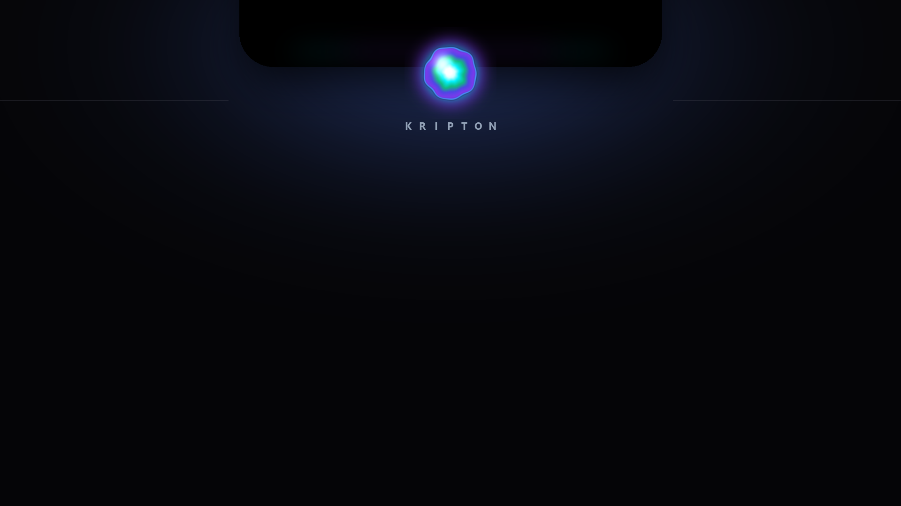

# Kripton

**Living notch untuk Windows.** Terinspirasi oleh **Nusa**, Kripton adalah aplikasi desktop native yang menempel di tepi atas layar (tengah) dan berubah bentuk dengan fisika pegas: garis *stealth* yang bernapas saat idle, kapsul ringkas saat media/fokus aktif, hingga panel kaca transparan untuk kontrol musik, lirik sinkron, timer fokus, pelacak minum, rak file, to-do, serta HUD headphone dan baterai.

Dibangun **100% dengan Rust + Slint (FemtoVG)** — tanpa Electron, WebView2, atau proses tambahan.



---

## Tampilan & Dimensi

Kripton memakai gaya **Monochrome White Transparent Glassmorphism** di atas permukaan *smoked glass* netral (`#131316C4` → `#09090BD6`, stealth `#0D0D10BA`) dengan komponen putih *frosted glass*, *perimeter rim* 1 px, dan kanvas transparan `540 × 204 px` (lihat [`DIMENSIONS.md`](DIMENSIONS.md)).

| Mode | Ukuran Visual | Perilaku |
| :--- | :---: | :--- |
| **Stealth** | `128 × 4 px` | Garis mikro di tepi atas saat idle tanpa media maupun timer fokus aktif (*wake strip* `148 × 6 px`). |
| **Compact / Closed** | `260 × 28 px` | Aktif otomatis (*Smart Adaptive*) saat audio/media berjalan atau timer fokus aktif (`PlasmaOrb`, jam, timer fokus, baterai, 5-bar wave). Melebar ke `276 × 30 px` saat hover. |
| **Expanded / Lyrics** | `476 × 172 px` | Terbuka saat diklik: header ringkas, area konten `452 × 104 px` untuk 5 halaman, dan *expanding tab dock* di bawah. |
| **Hardware HUD** | `268 × 54 px` / `256 × 50 px` | Notifikasi transien 3 detik saat headphone tersambung/putus atau status charger/baterai berubah. |

---

## Fitur Utama

- **Living Plasma Core (`PlasmaOrb`)**: Maskot tiga lapis (*core*, *corona*, *aura*) yang bernapas pada `0.25 Hz`, tertarik ke kursor (*ferrofluid pull*), dan berubah hangat saat pengingat minum aktif.
- **Music & Live Lyrics**: Kontrol playback via WinRT SMTC (*play/pause*, *prev/next*, *seek bar*, buka aplikasi sumber via AUMID), visualizer 5-band real-time via WASAPI loopback FFT, dan split-view lirik tersinkron dari LRCLIB dengan cache lokal.
- **Focus Timer**: Pomodoro 25/5 dengan preset `15/25/45/60` menit, penyesuaian cepat `-5`/`+5` menit, cincin progres 60 fps, chime *in-memory*, dan penghitung sesi harian.
- **Water Tracker**: Pelacakan asupan harian (default `2.000 ml`, dapat diubah lewat tray), tombol cepat `+150` / `+250` / `+500 ml`, `Undo`, animasi gelombang ganda, dan pengingat 90 menit.
- **File & Folder Shelf**: *OLE drag-and-drop* langsung dari Explorer, carousel hingga 5 kartu dengan thumbnail gambar, hapus per item (`×`), `Clear`, dan buka via `ShellExecute`.
- **Quick To-do**: Input inline, checklist dengan animasi *strikethrough*, *drag-to-reorder*, `Clear done`, dan persistensi otomatis.
- **Hardware HUD & System Tray**: Deteksi endpoint headphone (`IMMNotificationClient`), status baterai/AC (`GetSystemPowerStatus`), serta menu tray (`Show/Hide`, `Start with Windows`, `Lyrics`, `Water goal`, `Quit`).

---

## Kontrol Singkat

| Aksi | Hasil |
| :--- | :--- |
| Arahkan kursor ke tepi atas tengah | Bangun dari Stealth ke Compact Pill (`276 × 30 px`) |
| Klik Compact Pill / klik header atau tombol chevron | Buka atau tutup mode Expanded (`476 × 172 px`) |
| Klik tab dock atau gulir *mouse wheel* di header/dock | Berpindah halaman (`Music`, `Focus`, `Water`, `Shelf`, `To-do`) |
| Drag file/folder ke arah notch | Membuka halaman `Shelf` dan menambahkan item otomatis |
| Drag grip titik di sebelah kiri baris To-do | Mengubah urutan tugas secara langsung |
| Klik kanan notch | Keluar dari Kripton (alternatif selain menu System Tray) |
| Klik di luar area notch | Tembus klik ke aplikasi di bawahnya (`WS_EX_TRANSPARENT`) |

---

## Arsitektur Proyek

```text
src/
├── main.rs           # bootstrap Slint, COM STA, timer jam/baterai, wiring callback
├── window_ext.rs     # Win32 overlay, hover hysteresis, spring morph loop 60 fps, runtime
├── spring.rs         # integrator pegas teredam (ζ ≈ 0.72, ω ≈ 17 rad/s)
├── living.rs         # animasi PlasmaOrb, ferrofluid cursor pull, 5-bar spectrum, hysteresis media
├── state.rs          # NotchMode, Page, persistensi atomik %APPDATA%\Kripton\state.json
├── media.rs          # worker WinRT SMTC: metadata, artwork, transport, seek, AUMID launcher
├── lyrics.rs         # LRCLIB fetcher, parser LRC, cache memori & disk
├── wave.rs           # WASAPI loopback capture & radix-2 FFT 512 titik → 5 pita
├── shelf.rs          # OLE IDropTarget (CF_HDROP) & generator thumbnail
├── focus.rs          # timer Pomodoro berbasis GetTickCount64 + audio chime
├── water.rs          # pelacak hidrasi harian, undo, pengingat 90 menit
├── todo.rs           # operasi CRUD & reorder checklist
├── hud.rs            # state machine HUD 3 detik & transisi daya
├── headphone.rs      # IMMNotificationClient untuk deteksi headphone default
├── system.rs         # pembacaan baterai & kalkulasi busur ring
├── tray.rs           # ikon System Tray & antrean aksi Win32
└── autostart.rs      # manajemen HKCU Run key

ui/
├── appwindow.slint   # siluet notch kontinu, crossfade, header, dan expanding tab dock
├── theme.slint       # token Monochrome White Transparent Glassmorphism
├── icons.slint       # kumpulan ikon vektor
├── components.slint  # GlassPillButton, GlassIconButton, BatteryRing, AudioWave, PlasmaOrb
├── compact.slint     # tampilan Stealth filament & Compact/Closed Pill 3-slot
├── hud.slint         # Hardware HUD (Headphone & Charging)
└── pages/            # music.slint, focus.slint, water.slint, shelf.slint, todo.slint
```

> **Renderer:** **FemtoVG** digunakan agar transparansi *per-pixel alpha* pada Windows berjalan bersih tanpa artefak latar hitam.

---

## Build & Pengujian

**Kebutuhan:** Windows 10 (22H2) / Windows 11, Rust **1.92+** (`x86_64-pc-windows-msvc`), dan Visual Studio Build Tools (Windows SDK + C++ workload).

```powershell
# Jalankan versi development
cargo run

# Build rilis tunggal (target\release\kripton.exe)
cargo build --release
```

Verifikasi format, lint, dan unit test (**66 test**):

```powershell
cargo fmt --all -- --check
cargo clippy --all-targets -- -D warnings
cargo test
```

> Jika `cargo build --release` gagal karena file terkunci, hentikan proses `kripton.exe` yang sedang berjalan terlebih dahulu. Data lokal disimpan di `%APPDATA%\Kripton\state.json` dan log di `%APPDATA%\Kripton\kripton.log` tanpa telemetri.

---

## Inspirasi & Lisensi

Kripton terinspirasi oleh konsep dan desain **Nusa**, menghadirkan pengalaman *living notch* yang ringkas, responsif, dan ringan di Windows.

MIT © 2026 Kripton. Lihat [`LICENSE`](LICENSE).
