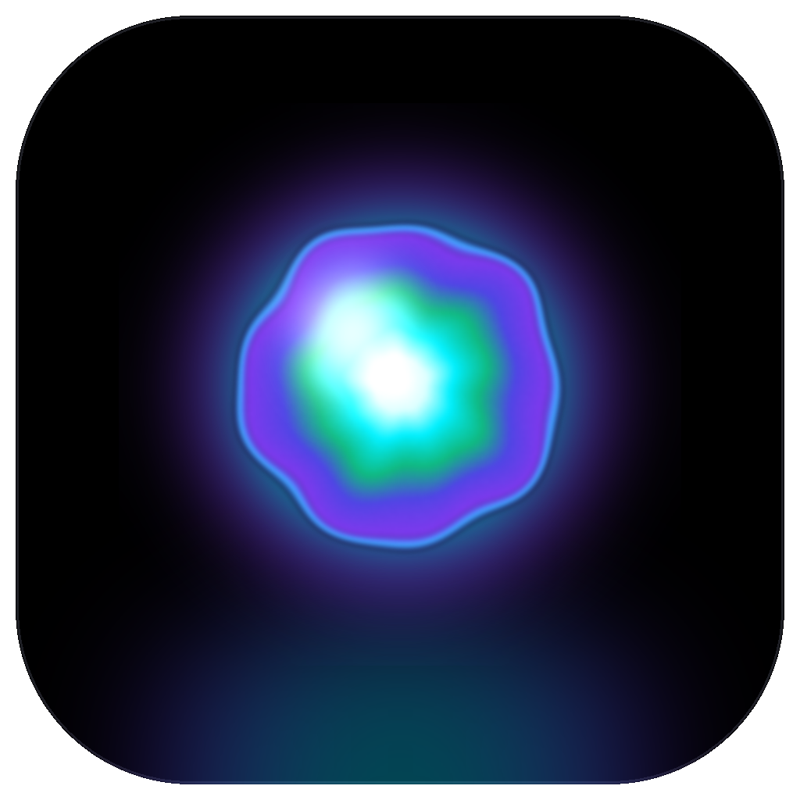

<div align="center">



# Kripton

**Native Windows living notch — built with 100% Rust & Slint.**

[](#kebutuhan--build-dari-source)
[](#arsitektur)
[](#instalasi--build)
[](LICENSE)

[Fitur Utama](#fitur-utama) · [Tampilan & Dimensi](#tampilan--dimensi) · [Kontrol](#kontrol) · [Instalasi & Build](#instalasi--build) · [Arsitektur](#arsitektur)

</div>

---

Terinspirasi oleh **Nusa**, **Kripton** menyulap area tengah atas layar Windows menjadi *living notch* interaktif berbasis fisika pegas dan *monochrome white transparent glassmorphism* — tanpa Electron, WebView2, atau proses latar belakang berat.

---

## Fitur Utama

| Modul | Kemampuan |
| :--- | :--- |
| **Living Plasma Core** | Maskot tiga lapis (*core*, *corona*, *aura*) yang bernapas pada `0.25 Hz`, tertarik oleh posisi kursor (*ferrofluid pull*), dan berubah hangat saat pengingat minum aktif. |
| **Music & Live Lyrics** | Kontrol playback via WinRT SMTC (*play/pause*, *prev/next*, *seek bar*, buka app sumber via AUMID), visualizer 5-band real-time via WASAPI loopback FFT, dan lirik tersinkron split-view dari LRCLIB dengan cache lokal. |
| **Focus Timer** | Pomodoro 25/5 dengan preset `15/25/45/60` menit, penyesuaian cepat `-5`/`+5` menit, cincin progres 60 fps, *chime* in-memory, dan penghitung sesi harian. |
| **Water Tracker** | Target hidrasi harian (default `2.000 ml`, dapat diubah lewat tray), tombol cepat `+150` / `+250` / `+500 ml`, `Undo`, gelombang cairan ganda, dan pengingat 90 menit. |
| **File & Folder Shelf** | *OLE drag-and-drop* langsung dari Explorer, carousel hingga 5 item dengan thumbnail gambar, hapus per item (`×`), `Clear`, dan buka via `ShellExecute`. |
| **Quick To-do** | Input inline, checklist dengan animasi *strikethrough*, *drag-to-reorder* langsung, `Clear done`, dan penyimpanan otomatis. |
| **Hardware HUD & Tray** | Pop-up otomatis 3 detik saat headphone tersambung/putus (`IMMNotificationClient`) atau status baterai/AC berubah (`GetSystemPowerStatus`), plus ikon System Tray lengkap. |

---

## Tampilan & Dimensi

Kripton memakai tampilan **Monochrome White Transparent Glassmorphism**: bodi kaca gelap transparan netral dengan tombol, tab aktif, *progress bar*, dan *audio wave* bernuansa putih *frosted glass*. Seluruh area di luar kapsul *notch* bersifat tembus pandang dan tembus klik (*click-through*), sehingga tab browser di kiri dan kanan tetap bisa diklik normal.

**Alur transisi (*Smart Adaptive*):**
- **Idle** (tanpa musik & timer) → menyusut menjadi garis tipis **Stealth** (`128 × 4 px`).
- **Musik / Timer aktif** → otomatis tampil sebagai **Compact Pill** (`260 × 28 px`).
- **Hover kursor** → bangun/melebar ke **Compact Hover** (`276 × 30 px`).
- **Klik** → terbuka menjadi panel **Expanded** (`476 × 172 px`).

| Mode | Ukuran Notch | Area Sensor | Kapan Muncul & Isi Tampilan |
| :--- | :---: | :---: | :--- |
| **Stealth** | `128 × 4 px` | `148 × 6 px` | Saat idle tanpa media maupun timer — garis filamen tipis di tepi atas layar. |
| **Compact (Active)** | `260 × 28 px` | `284 × 40 px` | Otomatis muncul saat audio/media berjalan atau timer fokus aktif (`PlasmaOrb`, sisa timer, jam, baterai, 5-bar wave). |
| **Compact (Hover)** | `276 × 30 px` | `300 × 42 px` | Saat kursor menyentuh area sensor atas — siap diklik untuk membuka panel penuh. |
| **Expanded / Lyrics** | `476 × 172 px` | `500 × 184 px` | Saat diklik — panel penuh (`452 × 104 px` area konten) berisi 5 tab (`Music/Lyrics`, `Focus`, `Water`, `Shelf`, `To-do`). |
| **Headphone HUD** | `268 × 54 px` | `292 × 66 px` | Pop-up otomatis selama 3 detik saat perangkat audio tersambung atau terputus. |
| **Charging HUD** | `256 × 50 px` | `280 × 62 px` | Pop-up otomatis selama 3 detik saat charger dicolok, dilepas, atau baterai rendah/penuh. |

> **Catatan teknis:** Kanvas transparan berukuran `540 × 204 px` disediakan untuk menampung animasi pegas tanpa terpotong. Saat *notch* aktif, area sensor diberi toleransi `+12 px` di sekeliling kapsul agar tidak langsung menutup saat kursor bergeser sedikit (lihat [`DIMENSIONS.md`](DIMENSIONS.md)).

---

## Kontrol

| Aksi | Hasil |
| :--- | :--- |
| Arahkan kursor ke tepi atas tengah | Bangun dari Stealth ke Compact Pill (`276 × 30 px`) |
| Klik Compact Pill / klik header atau chevron | Buka atau tutup mode Expanded (`476 × 172 px`) |
| Klik tab dock atau gulir *mouse wheel* di header/dock | Berpindah halaman (`Music`, `Focus`, `Water`, `Shelf`, `To-do`) |
| Drag file/folder dari Explorer ke notch | Membuka halaman `Shelf` dan menambahkan item otomatis |
| Drag grip titik di sisi kiri baris To-do | Mengubah urutan tugas secara langsung |
| Klik kanan notch | Keluar dari Kripton (alternatif selain menu System Tray) |
| Klik di luar area notch | Tembus klik ke aplikasi di bawahnya (`WS_EX_TRANSPARENT`) |

---

## Instalasi & Build

### Installer Windows (Per-User, Tanpa UAC)

Kompilasi executable rilis terlebih dahulu lalu bangun installer lewat **Inno Setup 6** (`installer/kripton.iss`) untuk menghasilkan `dist\Kripton-1.0.0-setup.exe` (mendukung opsi *Start with Windows* via `HKCU` tanpa hak administrator).

### Kebutuhan & Build dari Source

- Windows 10 (`22H2`) atau Windows 11
- Rust **1.92+** (`x86_64-pc-windows-msvc`)
- Visual Studio Build Tools (*Windows SDK* + *C++ workload*)

```powershell
# Jalankan versi development
cargo run

# Build rilis tunggal (target\release\kripton.exe)
cargo build --release
```

Verifikasi format, lint, dan unit test (**66 test**):

```powershell
cargo fmt --all -- --check
cargo clippy --all-targets -- -D warnings
cargo test
```

> [!TIP]
> Jika `cargo build --release` gagal karena file terkunci, hentikan proses `kripton.exe` yang sedang berjalan terlebih dahulu.

---

## Arsitektur

Kripton memisahkan worker audio/SMTC/OLE ke thread latar belakang agar *UI thread* tetap berjalan halus pada `60 fps` dengan animasi pegas teredam (`ζ ≈ 0.72`, `ω ≈ 17 rad/s`).

<details>
<summary><strong>Struktur Modul (<code>src/</code> &amp; <code>ui/</code>)</strong></summary>

```text
src/
├── main.rs           # bootstrap Slint, COM STA, timer jam/baterai, wiring callback
├── window_ext.rs     # Win32 overlay, hover hysteresis, spring morph loop 60 fps, runtime
├── spring.rs         # integrator pegas teredam (ζ ≈ 0.72, ω ≈ 17 rad/s)
├── living.rs         # animasi PlasmaOrb, ferrofluid cursor pull, 5-bar spectrum, hysteresis media
├── state.rs          # NotchMode, Page, persistensi atomik %APPDATA%\Kripton\state.json
├── media.rs          # worker WinRT SMTC: metadata, artwork, transport, seek, AUMID launcher
├── lyrics.rs         # LRCLIB fetcher, parser LRC, cache memori & disk
├── wave.rs           # WASAPI loopback capture & radix-2 FFT 512 titik → 5 pita
├── shelf.rs          # OLE IDropTarget (CF_HDROP) & generator thumbnail
├── focus.rs          # timer Pomodoro berbasis GetTickCount64 + audio chime
├── water.rs          # pelacak hidrasi harian, undo, pengingat 90 menit
├── todo.rs           # operasi CRUD & reorder checklist
├── hud.rs            # state machine HUD 3 detik & transisi daya
├── headphone.rs      # IMMNotificationClient untuk deteksi headphone default
├── system.rs         # pembacaan baterai & kalkulasi busur ring
├── tray.rs           # ikon System Tray & antrean aksi Win32
└── autostart.rs      # manajemen HKCU Run key

ui/
├── appwindow.slint   # siluet notch kontinu, crossfade, header, dan expanding tab dock
├── theme.slint       # token Monochrome White Transparent Glassmorphism
├── icons.slint       # kumpulan ikon vektor
├── components.slint  # GlassPillButton, GlassIconButton, BatteryRing, AudioWave, PlasmaOrb
├── compact.slint     # tampilan Stealth filament & Compact/Closed Pill 3-slot
├── hud.slint         # Hardware HUD (Headphone & Charging)
└── pages/            # music.slint, focus.slint, water.slint, shelf.slint, todo.slint
```

</details>

---

## Privasi, Inspirasi & Lisensi

- **100% Lokal**: State tersimpan di `%APPDATA%\Kripton\state.json` dan log di `%APPDATA%\Kripton\kripton.log` tanpa telemetri (permintaan jaringan hanya ke LRCLIB saat mode lirik aktif).
- **Inspirasi**: Terinspirasi oleh konsep dan desain **Nusa**.
- **Lisensi**: MIT © 2026 Kripton. Lihat [`LICENSE`](LICENSE).
