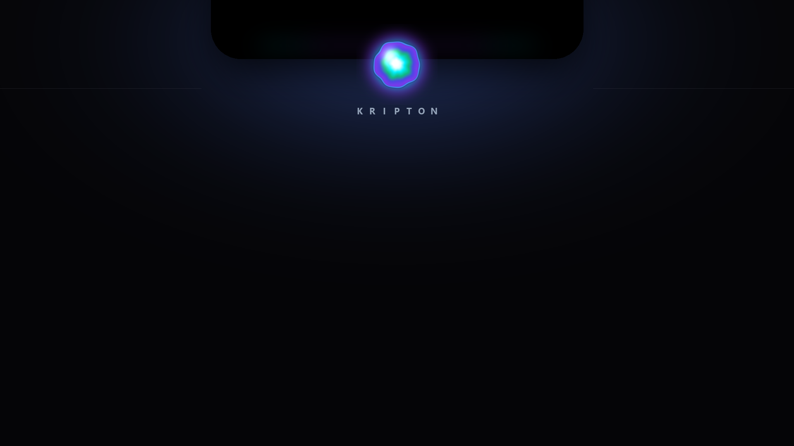

# Kripton

**Living notch untuk Windows.** Kripton adalah aplikasi desktop native yang menempel di tepi atas layar, tepat di tengah, dan berubah bentuk seperti *notch* macOS: orb plasma yang bernapas saat idle, kontrol musik, lirik sinkron, timer fokus, pelacak air, rak file, to-do, serta HUD headphone dan baterai.

Dibangun **100% dengan Rust + Slint**. Tidak ada Electron, WebView2, browser scraping, Discord RPC, skrip eksternal, atau database eksternal.

> Status: **Sprint 0 — Foundation selesai**. Shell UI, geometri notch, transparansi native, hover, navigasi 5 halaman, dan persistensi state sudah berjalan. Halaman fitur menyusul pada sprint berikutnya (lihat [`SPRINTS.md`](SPRINTS.md)).



*Arah visual: notch hitam pekat dengan Ionized Plasma Core. Concept art dibuat secara prosedural dari prompt PRD.*

---

## Tampilan

| Idle | Expanded |
| --- | --- |
| Orb plasma di notch 190 × 38 px | Shell 460 × 175 px dengan header, kartu halaman, dan pagination |

Palet: hitam pekat `#000000`, icy cyan `#00F0FF`, emerald `#10B981`, krypton violet `#7C3AED`, dengan aksen indigo `#4F46E5`.

---

## Fitur yang direncanakan

- [x] **Foundation** — window transparan top-center, notch dengan *inverse concave fillets*, hover expand/collapse, state JSON.
- [ ] **Idle** — plasma core bernapas 0.25 Hz + ferrofluid cursor pull.
- [ ] **Closed** — battery ring, jam digital, live sound wave 5 batang.
- [ ] **Music** — WinRT SMTC, album art, transport, seek slider.
- [ ] **Lyrics** — LRCLIB + lirik tersinkron, melebar 560 px.
- [ ] **Focus** — Pomodoro in-notch + chime.
- [ ] **Water** — target harian, gelombang cairan, pengingat.
- [ ] **Shelf** — drag & drop OLE, carousel file/folder.
- [ ] **To-do** — checklist cepat, strikethrough.
- [ ] **HUD** — headphone connect & charging pop-up 3 detik.
- [ ] **System** — tray icon, autostart, single instance, installer.

---

## Arsitektur

```
src/
├── main.rs           # bootstrap Slint, timer jam, wiring callback
├── state.rs          # Page/NotchMode, state.json atomik, normalisasi harian
└── window_ext.rs     # Win32 overlay: topmost, toolwindow, click-through, hover

ui/
└── appwindow.slint   # shell notch, silhouette Path, idle + expanded

assets/
├── icon.ico          # ikon executable
├── plasma_core.png   # maskot Ionized Plasma Core
└── chime.wav         # chime timer fokus

tools/
└── generate_assets.py  # generator aset prosedural (Pillow + NumPy)
```

**Prinsip geometri**

- Kanvas native selalu **600 × 220 px** dan transparan; notch dianimasikan di dalamnya sehingga shadow/overshoot tidak terpotong.
- Siluet notch digambar sebagai satu `Path` dinamis: telinga cekung 12 px di kiri/kanan atas, sudut bawah membulat 18 px.
- Transisi ukuran memakai kurva *slightly underdamped* `cubic-bezier(0.34, 1.22, 0.64, 1)` untuk membal halus khas Apple.
- Window memakai `WS_EX_TOOLWINDOW | WS_EX_NOACTIVATE`, selalu topmost, dan `WS_EX_TRANSPARENT` saat kursor di luar notch agar klik menembus ke aplikasi di bawahnya.

> Renderer: **FemtoVG**. Renderer Skia/Direct3D milik Slint saat ini merender area transparan sebagai hitam di Windows, sehingga FemtoVG dipakai untuk alpha yang benar.

---

## Kebutuhan

- Windows 10 22H2 atau Windows 11
- Rust **1.92+** dengan toolchain MSVC (`x86_64-pc-windows-msvc`)
- Visual Studio Build Tools (Windows SDK + C++ workload)
- Python 3.10+ (hanya jika ingin membuat ulang aset)

## Build & jalankan

```powershell
cargo build
cargo run
```

Build pertama mengompilasi Slint dan cukup berat. Jika RAM terbatas, batasi paralelisme:

```powershell
cargo build -j 1
```

Build rilis:

```powershell
cargo build --release
# hasil: target\release\kripton.exe
```

## Kontrol (Sprint 0)

| Aksi | Hasil |
| --- | --- |
| Arahkan kursor ke notch (60 ms) | Notch membesar ke 460 × 175 px |
| Jauhkan kursor (250 ms) | Notch mengecil kembali |
| Klik notch | Toggle expand/collapse |
| Klik titik pagination | Pindah halaman (Music/Focus/Water/Shelf/To-do) |
| Klik kanan notch | Keluar dari aplikasi (sementara, sampai tray hadir) |
| Klik di luar notch | Diteruskan ke aplikasi di bawahnya (click-through) |

Hanya satu instance yang boleh berjalan; instance kedua langsung keluar.

## Data & privasi

State disimpan di:

```
%APPDATA%\Kripton\state.json
```

Log ringan (rotasi manual, tanpa telemetri):

```
%APPDATA%\Kripton\kripton.log
```

State ditulis lewat file sementara lalu `rename`, dan state korup dikarantina menjadi `state.corrupt-YYYYMMDD-HHMMSS.json`. Tidak ada data yang dikirim ke mana pun pada Sprint 0. Nanti, lirik hanya memanggil LRCLIB secara langsung saat mode Lyrics aktif; tidak ada analytics.

## Aset

Semua aset dibuat secara prosedural dari arah seni PRD:

```powershell
python tools/generate_assets.py
```

Menghasilkan `plasma_core.png`, `icon.ico`, `icon.png`, `plasma_core_concept.png`, dan `chime.wav`.

## Kualitas kode

```powershell
cargo fmt --all
cargo clippy --all-targets -- -D warnings
cargo test
```

CI Windows berjalan untuk fmt, clippy, dan test pada setiap push (`.github/workflows/ci.yml`).

## Lisensi

MIT © 2026 Kripton. Lihat [`LICENSE`](LICENSE).
